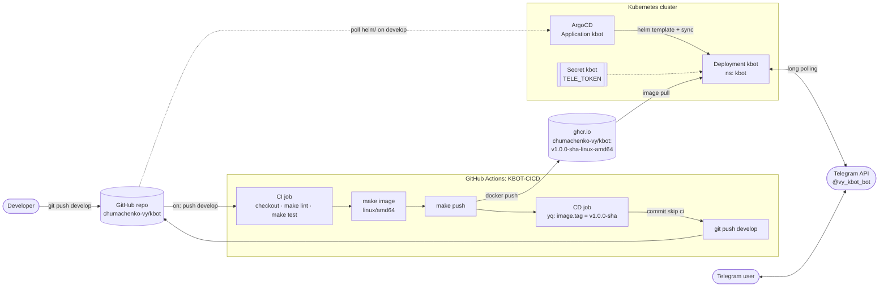

# kbot

Simple Telegram bot written in Go using [cobra](https://github.com/spf13/cobra) and [telebot v4](https://gopkg.in/telebot.v4).

Bot: [t.me/vy_kbot_bot](https://t.me/vy_kbot_bot)

## Installation

```bash
git clone https://github.com/chumachenko-vy/kbot.git
cd kbot
go build -ldflags "-X=github.com/chumachenko-vy/kbot/cmd.appVersion=v1.0.0"
```

## Usage

Get a bot token from [@BotFather](https://t.me/BotFather), set it and start the bot:

```bash
read -s "TELE_TOKEN?Paste token: "
export TELE_TOKEN
./kbot start
```

CLI commands:

- `./kbot version` — print version
- `./kbot start` — start the bot (alias for `./kbot kbot`)
- `./kbot --help` — help

Bot commands in Telegram:

- `/start` — greeting
- `/version` — bot version
- `hello` — bot replies with a greeting and its version
- any other text — bot replies that the command is unknown

## Build & Run with Make

```bash
make version            # v1.0.0-<short sha>
make test               # go test
make build              # local binary
make image push         # ghcr.io/chumachenko-vy/kbot:<version>-linux-amd64
make arm                # build & push linux/arm64 image
```

## CI/CD

Every push to the `develop` branch runs the [KBOT-CICD](.github/workflows/cicd.yaml) workflow:

1. **CI** — `make lint`, `make test`, build the image and push it to `ghcr.io`
   as `ghcr.io/chumachenko-vy/kbot:<tag>-<os>-<arch>`
   (`<tag>` = latest git tag + short commit SHA, e.g. `v1.0.0-106879e`).
2. **CD** — update `image.tag` in `helm/values.yaml` and commit it back to `develop` (`[skip ci]`).
3. **ArgoCD** watches `develop` / `helm/` ([argocd/kbot-app.yaml](argocd/kbot-app.yaml)),
   detects the new tag and syncs the Deployment in the Kubernetes cluster.



### Deploy with ArgoCD

```bash
kubectl create ns kbot
kubectl -n kbot create secret generic kbot --from-literal=token="$TELE_TOKEN"
kubectl apply -f argocd/kbot-app.yaml
```
